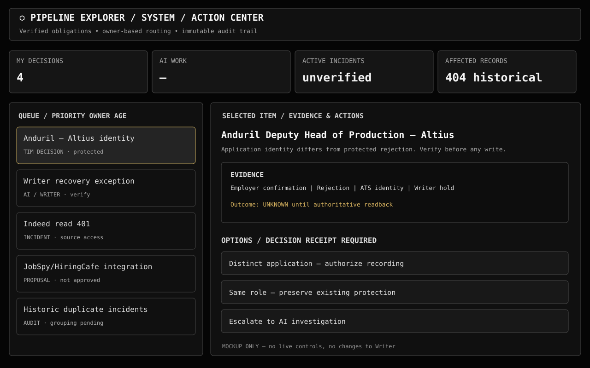
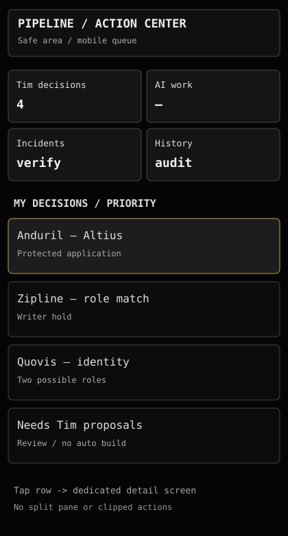

# Pipeline Explorer Action Center — proposed redesign

**Status:** PROPOSAL / no live changes.

## Why
Needs You blends Tim approvals, job identity holds, and hundreds of historical failures. Repeats and stale status inflate the queue. Some cards render [object Object]. It should separate active owner work from Tim decisions.

## Visual mockups

## Information architecture
**My Decisions:** Tim approvals and evidence-backed job identity rulings. **AI Work:** Claude, Grok, ChatGPT, Writer work with named owner, specific next action, and status. **Incidents:** distinct verified root causes with expandable affected rows. **History:** recovered and resolved receipts, still searchable. OPEN suggestions are reviewable, not urgent or approved.

## Interaction
Desktop 2560×1440 uses monochrome black/grey, condensed left queue, right persistent evidence/action details, generous perimeter padding. Mobile and iPhone landscape use separate queue/detail screens, safe area padding, no clipped controls.

## Lifecycle
Detected -> identity/status verified -> accountable owner -> authorized execution -> receipt readback -> resolved. If verification fails: UNKNOWN or BLOCKED, never automatic success. Tim rulings persist to asks/resolved. Every affected record and protected application stays traceable.

## Phases
A: reconcile sources, dedupe by root-cause, fix counts, verify ownership and regressions.
B: queue/detail responsive page, search, severity/owner/status filters.
C: closed-loop decisions and verified Writer/master readback.

## Acceptance criteria
- One root incident for 100 failures, 100 affected rows with drilldown.
- Recovered writes leave ACTIVE but remain in immutable history.
- AI-owned tasks do not count as Tim decisions.
- No literal [object Object] in UI.
- Source freshness and UNKNOWN clearly distinguished.
- Protected APPLIED/REJECTED/DECLINED history cannot be overwritten.
- Suggestions OPEN vs APPROVED clearly distinguished; no build without Tim.
- Desktop at 2560×1440 and iPhone landscape retain reachable controls.
- End-to-end decision-to-readback tests include failures and ambiguous identities.
